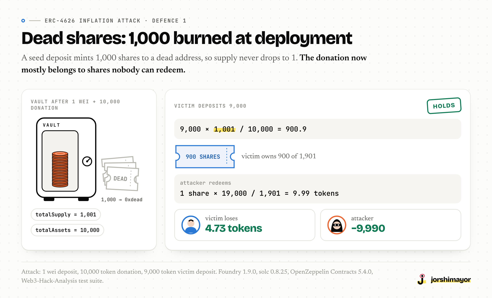
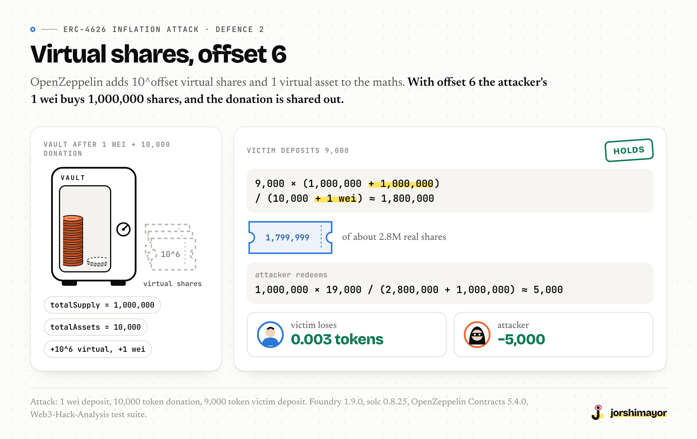
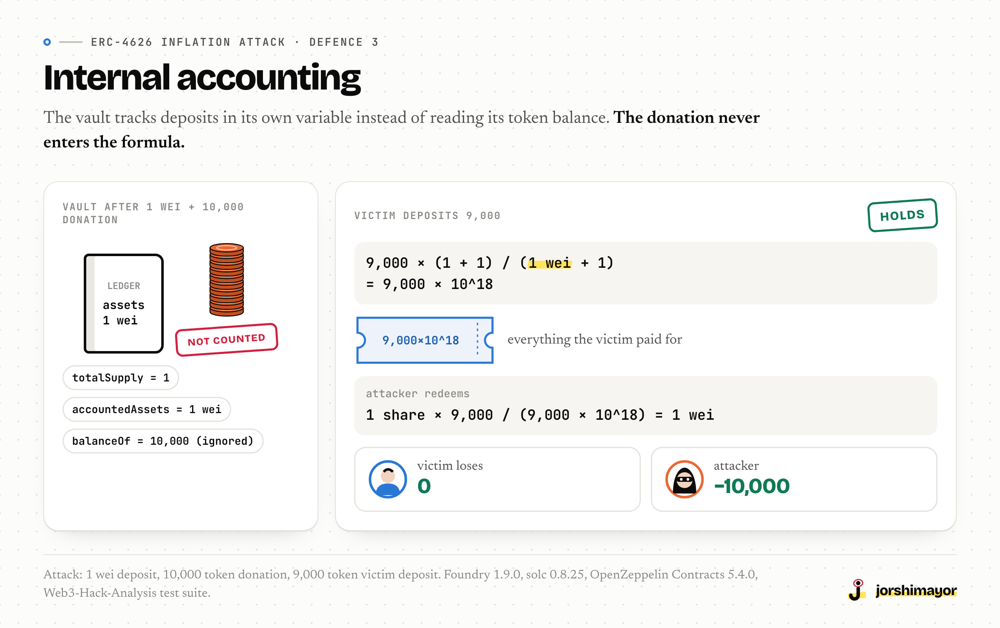
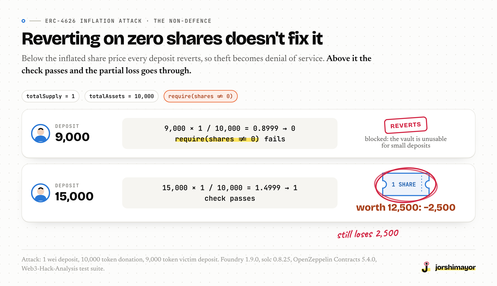

# ERC-4626 Inflation Attack: 3 Defences That Hold, 1 That Fails

The ERC-4626 inflation attack targets the interface most DeFi yield now sits behind. [ERC-4626](https://eips.ethereum.org/EIPS/eip-4626), the tokenised vault standard finalised in 2022, says how a vault takes in one ERC-20 asset and hands back another ERC-20, the share, that represents a claim on the pool. Yearn v3 vaults, Morpho vaults, liquid staking wrappers, lending-market receipt tokens and most staking contracts written since then expose the same eight functions. An aggregator or a front end can plug into any of them without reading the code.

```solidity
// The ERC-4626 surface, abridged from the standard
function asset() external view returns (address);
function totalAssets() external view returns (uint256);
function deposit(uint256 assets, address receiver) external returns (uint256 shares);
function mint(uint256 shares, address receiver) external returns (uint256 assets);
function withdraw(uint256 assets, address receiver, address owner) external returns (uint256 shares);
function redeem(uint256 shares, address receiver, address owner) external returns (uint256 assets);
function convertToShares(uint256 assets) external view returns (uint256);
function convertToAssets(uint256 shares) external view returns (uint256);
```

The share itself is a plain ERC-20, so `totalSupply()`, `balanceOf()` and `transfer()` come from the ERC-20 interface the vault extends rather than from ERC-4626. Everything above hangs off one ratio: `totalAssets()` to `totalSupply()`. Deposit and you get shares in proportion to it. Redeem and you get assets in proportion to it. The standard says how to round and which way, and leaves how `totalAssets()` is measured to the implementer. Nearly everyone measures it the obvious way, as the vault's token balance.

That choice is where the ERC-4626 inflation attack lives, and the whole attack fits in one block. A new vault goes live, the first honest deposit of 9,000 tokens is in the mempool, and someone deposits 1 wei ahead of it and sends 10,000 tokens straight to the vault's address. The honest transaction succeeds, the tokens leave the user's wallet, and the vault mints zero shares.

The attack has been public as long as the standard. The fix has shipped in [OpenZeppelin Contracts since version 4.9](https://github.com/OpenZeppelin/openzeppelin-contracts/pull/3979) in 2023. It still landed in 2025 and 2026: once as a critical finding in Belong's audit competition, once as a $50,000 loss on a newly deployed Thetanuts vault. Most teams that get hit did try to defend, and got the defence almost right.

What follows is the one line of integer division that makes the ERC-4626 inflation attack possible, three ways to change the formula, one popular change that does nothing useful, and [a Foundry test suite](https://github.com/jorshimayor) that runs the attack against all of them. The numbers in this piece come from that suite.

So what does the ratio do with a deposit?

## How Does the ERC-4626 Inflation Attack Work?

An ERC-4626 inflation attack works because the share price is a ratio anyone can move. Share price manipulation is the whole game. When you deposit into a tokenised vault you get shares, and the number is:

```text
shares = assets × totalSupply() / totalAssets()
```

rounded down, because [the standard](https://eips.ethereum.org/EIPS/eip-4626) requires `deposit` and `mint` to round in the vault's favour. In most vaults `totalAssets()` is `asset.balanceOf(address(this))`. Anyone can raise it with a plain ERC-20 transfer to the vault address, and a plain transfer mints no shares. The numerator stays put while the denominator jumps.

Here is the vault inflation attack with the numbers from the test suite. Step 1: the attacker deposits 1 wei into the empty vault and gets 1 share, because the first deposit mints 1:1. Step 2: the attacker transfers 10,000 tokens to the vault. Supply is still 1 share and assets are now 10,000 tokens plus 1 wei, so one share is worth 10,000 tokens.

Step 3: the victim deposits 9,000 tokens. The formula gives 9,000 × 1 / 10,000.000…1, which is 0.8999, which rounds down to 0. The victim's tokens are in the vault and they own nothing. Step 4: the attacker redeems their single share for the entire balance, 19,000 tokens and 1 wei. Profit: the victim's 9,000.


This is why the ERC-4626 inflation attack also goes by first depositor attack. It only works while supply is tiny, so in practice the attacker either front-runs the first real deposit or targets a vault that has drained back to near zero. Both have happened.

It is worth separating it from the attacks it resembles. It is a front-run, so it uses the same block-ordering tools as any MEV strategy, but it is only the first half of a sandwich: there is no back-run, because the profit comes from the vault's rounding rather than from price impact. It usually cannot use a flash loan either. The donation has to sit in the vault across two transactions, the attacker's and the victim's, and a flash loan must be repaid inside one. The attacker needs real capital at least as large as the deposit they are targeting. Flash loans only appear in the configuration cases later in this piece, where every step happens inside a single transaction.

### Why Rounding Down Is the Real Weapon in a First Depositor Attack

The donation sets the price of a share. Rounding is what takes the money. The standard's rule that the vault must never pay out more than it is owed is correct in isolation. An ERC-4626 inflation attack points that rule at the next depositor.

The zero-shares case is the dramatic one, but it hides something. Change the victim's deposit to 15,000 tokens and the formula gives 1.4999, which rounds to 1 share. The victim now owns 1 of 2 shares in a vault holding 25,000 tokens, so their share is worth 12,500. They put in 15,000.

The missing 2,500 went to the attacker's share, which is now also worth 12,500 against a cost of 10,000. The victim received shares, the transaction looked normal, and they still lost 16.7% of their deposit. A first depositor attack does not need the zero.


Every ERC-4626 inflation attack defence below changes one term of that formula. Keep the formula in view and the trade-offs explain themselves.

## Defence 1: Dead Shares, the Uniswap V2 Approach

The oldest fix for the ERC-4626 inflation attack predates ERC-4626. [Uniswap V2 pairs](https://docs.uniswap.org/contracts/v2/reference/smart-contracts/pair) burn the first 1,000 liquidity tokens to `address(0)` on the first mint, so no single account can ever own the entire supply. The constant is called `MINIMUM_LIQUIDITY`, and those dead shares are a floor under `totalSupply`.

For a vault, the clean way to do this is a real seed deposit at deployment whose shares go to a dead address. The deployer deposits 1,000 wei of the asset in the constructor, the vault mints 1,000 shares for it, and those shares go to `0xdead`.

Two details matter. First, OpenZeppelin's ERC20 reverts on `_mint(address(0), …)`, so use `0x000000000000000000000000000000000000dEaD` or a dedicated burn contract. Second, the dead shares must be backed by a real deposit. Minting 1,000 shares against zero assets leaves the next depositor dividing by zero in a naive implementation.

```solidity
// Unaudited example. Testnet only, never with real funds.
address public constant DEAD = 0x000000000000000000000000000000000000dEaD;
uint256 public constant DEAD_SHARES = 1000;

constructor(IERC20 asset_) NaiveVault(asset_, false) {
    // First deposit mints 1:1, so DEAD_SHARES wei of asset buys DEAD_SHARES shares.
    asset_.safeTransferFrom(msg.sender, address(this), DEAD_SHARES);
    _mint(DEAD, DEAD_SHARES);
}
```

Now run the ERC-4626 inflation attack against it. The attacker's 1 wei buys 1 share, but there are already 1,000 others. After the 10,000 token donation each share is worth about 10 tokens rather than 10,000, so the victim's 9,000 tokens mint 900 shares. In the test the attacker redeems for 9.99 tokens and loses 9,990. The donation is now mostly owned by the dead shares, locked in the vault forever.

The victim is not quite whole, though. They get back 8,995.27 tokens, a loss of 4.73 tokens or 0.05%, because rounding still favours the vault and the dead shares absorb the difference. Against a first depositor attack that is a good outcome, and it is not zero.



The protection also scales with the seed. 1,000 dead shares make the vault inflation attack 1,000 times more expensive, and no more. A vault that will hold tens of millions with a seed of 1,000 wei has a thin floor. Size the seed to the deposits you expect and write the step into the deployment script. This is a deploy-time defence, and a forgotten deploy step is exactly the Belong finding.

Dead shares cost real assets, locked for good. OpenZeppelin's ERC-4626 inflation attack defence costs none.

## Defence 2: Virtual Shares and the Decimals Offset, the OpenZeppelin Approach

OpenZeppelin's `ERC4626` has converted with virtual shares and virtual assets since Contracts 4.9, where [PR #3979](https://github.com/OpenZeppelin/openzeppelin-contracts/pull/3979) landed on 17 February 2023:

```solidity
// OpenZeppelin Contracts, ERC4626.sol (abridged)
function _convertToShares(uint256 assets, Math.Rounding rounding) internal view virtual returns (uint256) {
    return assets.mulDiv(totalSupply() + 10 ** _decimalsOffset(), totalAssets() + 1, rounding);
}
```

The vault behaves as if it already held `10 ** offset` virtual shares against 1 wei of assets. The empty-vault exchange rate is defined from the start. Any donation is diluted across the virtual shares as well as the real ones, so the attacker's own position captures less of it than they spent.

The catch is `_decimalsOffset()`. It defaults to 0, which means one virtual share and one virtual asset. [OpenZeppelin's guide](https://docs.openzeppelin.com/contracts/erc4626) is careful about what that buys you. With offset 0 the ERC-4626 inflation attack is unprofitable for the attacker, and no more than that. The victim can still lose.

In my run the default vault gave the victim 1 share and returned 6,333 of their 9,000 tokens, a 29.6% loss. The attacker lost 3,667. The rest, 6,333 tokens, is now owned by the single virtual share, which is to say by nobody. A HackenProof disclosure against cUSDO in October 2025 found the same shape, with victim losses of 9% to 25% on a vault that inherited the default. OpenZeppelin issue #5223 covers the same ground.

Each step of offset multiplies the attacker's cost by 10. OpenZeppelin's own charts use 3 and 6. With offset 6 the victim in my run got 1,799,999 shares and lost 0.003 tokens, while the attacker lost 5,000 of their 10,000. Nothing is locked at deployment, the override is one function, and the share token simply gets six extra decimals.



The trade-offs are small but real. The virtual shares take a sliver of yield that no one can redeem. Under losses, the virtual asset can make exits slightly off. Auditors sometimes need the maths explained. None of that compares with leaving the default in place and calling the ERC-4626 inflation attack handled.

### The One Virtual Shares Override Most Teams Forget

```solidity
// Unaudited example. Size the offset to the asset's decimals and the deposits you expect.
function _decimalsOffset() internal pure override returns (uint8) {
    return 6;
}
```

Add a line to your review checklist: grep every contract that inherits `ERC4626` for `_decimalsOffset`. If the override isn't there, the vault is running the default.

Both defences so far accept that `totalAssets()` can be inflated and make the share price manipulation expensive. The third refuses to count the donation at all.

## Defence 3: Internal Asset Accounting

Track deposited assets in a storage variable and have `totalAssets()` return it. A plain transfer to the vault then changes the token balance and nothing else, because the share price never looks at the balance. The ERC-4626 inflation attack has no donation step left to make.

```solidity
// Unaudited example on OpenZeppelin ERC4626. Testnet only.
uint256 private _accountedAssets;

function totalAssets() public view override returns (uint256) {
    return _accountedAssets;
}

function _deposit(address caller, address receiver, uint256 assets, uint256 shares) internal override {
    super._deposit(caller, receiver, assets, shares);
    _accountedAssets += assets;
}

function _withdraw(address caller, address receiver, address owner, uint256 assets, uint256 shares) internal override {
    _accountedAssets -= assets;
    super._withdraw(caller, receiver, owner, assets, shares);
}
```

Against the vault inflation attack this is the cleanest result in the suite. The victim got 9,000 × 10^18 shares for 9,000 tokens and redeemed every token back. The attacker redeemed 1 wei and lost the entire 10,000 token donation, which now sits in the vault as an unaccounted balance.



The cost is bookkeeping. Every path that moves assets has to update the variable: deposits, withdrawals, fees, harvests, strategy gains and losses. Yield has to be booked explicitly, and a strategy that returns more than it was given needs a hook to recognise it or the vault under-reports forever. Donated or stranded tokens need a sweep function or they're lost.

Internal accounting also says nothing about rounding when supply is tiny, so pair it with a seed deposit or an offset. Hold on to the phrase "the vault's accounted value". The two Yearn incidents in the timeline below are accounting mismatches of exactly this kind, just not deliberate ones.

Three ERC-4626 inflation attack defences, three different costs. Here they are side by side.


## Which ERC-4626 Inflation Attack Defence Should You Use?

The table compares the three ERC-4626 inflation attack defences on what they change, what they cost, and what they leave open. Figures are from the test suite with a 1 wei deposit, a 10,000 token donation and a 9,000 token victim.

| | Dead shares, 1,000 seed | Virtual shares, offset 6 | Internal accounting |
|---|---|---|---|
| Term changed | `totalSupply` has a floor | Both terms get virtual values | `totalAssets` ignores balance |
| Victim loss in the test | 4.73 tokens, 0.05% | 0.003 tokens | 0 |
| Attacker result | −9,990 | −5,000 | −10,000 |
| What it costs you | Seed assets locked; a deploy step | A sliver of yield; six extra share decimals | Hooks on every asset path |
| What it leaves open | Protection scales only with the seed | Default offset 0 still loses the victim 29.6% | Rounding at tiny supply; stranded tokens |
| Configuration risk | Forgetting the seed | Forgetting the override | Missing a path |
| Proven where | Uniswap V2, since 2020 | OpenZeppelin Contracts 4.9+ | Several audited vaults; see OpenZeppelin's survey |

Three things to notice. Virtual shares with a non-zero offset is the default answer for anyone already on OpenZeppelin, because it costs one function and nothing at deployment. Dead shares are the choice when you control deployment and want a floor that anyone can verify on-chain. Internal accounting is for vaults whose share price feeds something else, such as an oracle or a lending market, where share price manipulation by donation must not move the rate even for a block.


Choose dead shares if you deploy the vault yourself and want an auditable on-chain floor. Choose virtual shares if you inherit OpenZeppelin's `ERC4626`, and override the offset. Choose internal accounting if another contract reads your share price, and add a seed or offset for rounding. Combining an offset with a seed deposit is cheap and common.

Whatever you pick, keep a minimum-shares-out check in the front end or router as the user's own second layer. `deposit` in ERC-4626 has no slippage parameter, so the contract can't do it for them.

One more "defence" shows up in audits constantly. It is not one.

## Why Reverting on Zero Shares Doesn't Stop the Inflation Attack

The tempting fix is `require(shares != 0)` in `deposit`. Solmate's ERC4626 does it. It feels like the obvious guard against the ERC-4626 inflation attack, since zero shares is the symptom everyone describes.

It catches the total-loss case and nothing else. Run the 15,000 token deposit against a vault with the check: the formula gives 1 share, the check passes, and the victim still loses 2,500 tokens. The check never saw a problem.

It also turns theft into denial of service. Once the attacker has inflated the price, every deposit smaller than the price of one share reverts. In the test the 9,000 token deposit fails with `ZERO_SHARES`. The vault stays unusable at that size until someone deposits enough to mint a whole share, and that someone takes the rounding loss. Keep the check as a sanity guard, and treat the first depositor attack as unsolved until one of the three defences is in.



The test suite below shows all of this in a few hundred lines. First, the production record.

## What the Attack Looks Like in Production, 2023 to 2026

Six incidents, grouped by what moved the ratio. The two in blue are the textbook first depositor attack on an empty vault. The four in orange are share price manipulation by another route, and they're here because the defence is the same. Vulnerability class and fix only, no step-by-step against live contracts.


Belong Staking.sol, October 2025. Belong's audit competition on Immunefi produced several critical reports, [#57401](https://reports.immunefi.com/belong/57401-sc-critical-erc4626-inflation-attack-vulnerability) among them, for a plain ERC4626 staking vault with no initial mint in the deployment script. Caught before launch, no loss. This is the textbook ERC-4626 inflation attack: a standard library, a standard pattern, and a missing deploy step.

Thetanuts new vault, 20 April 2026. A newly deployed Thetanuts Finance vault lost roughly $50,000 to a first depositor attack, per SlowMist and DefiLlama's hacks list. Details are thin, but it is the one live ERC-4626 inflation attack of 2026 that matches the textbook.

Yearn yUSDT, 13 April 2023. About $11.6 million by PeckShield's count. The vault's Fulcrum address had pointed at bZx iUSDC instead of iUSDT since deployment three years earlier, a copy-paste error. The attacker used that to drive the vault's accounted value to near zero through `rebalance()`, then minted 1,252,660,242,212,927 yUSDT from a 10,000 USDT deposit. Same lever as the ERC-4626 inflation attack, pulled from the configuration side.

Yearn yTUSD, 16 December 2025. About $293,000. A near copy of the 2023 case: the legacy yTUSD vault's Fulcrum address pointed at iSUSD, so after a `rebalance()` the redeemed sUSD sat inside the vault unpriced and the share price collapsed. banteg's [technical write-up](https://github.com/banteg/iearn-2025-12-investigation/blob/master/technical-writeup.md) walks through it. About 214,000 sUSD remain in the contract with no code path to withdraw them.

Thetanuts legacy index token, 15 June 2026. Headlined at $2.1 million, about $105,000 net after whitehats recovered roughly $2 million in option tokens. Not an ERC-4626 vault, but the same arithmetic: a `claim()` drained the basket to near-zero supply, after which `mint()` rounded the required deposit down to zero and issued shares for free.

Summer.fi Lazy Summer, 6 July 2026. About $6.04 million across two USDC vaults, with a $65.4 million Morpho flash loan as the amplifier. The post-mortem names an impaired Silo strategy adapter that had been capped but not removed from the vault's active set. Tokens donated straight to that adapter counted in `totalAssets()` at a stale, inflated value, so the share price rose about 9.5% and the attacker redeemed against it. A donation attack against `totalAssets()`, one level down from the vault itself.

Two patterns. Donations, misconfigured accounting and near-zero supply all move the same ratio, so a vault inflation attack defence that only thinks about the deposit path misses half the record. And immutable legacy contracts stay exploitable for years: yUSDT for about three, yTUSD for over 2,100 days by Yearn's own count. If you can pause or drain a deprecated vault, do it. The step-by-step of each incident, with the post-mortem links, is in the companion case file.

None of these needed a new idea to prevent. They needed a test for the ERC-4626 inflation attack and a second look at the config.

## Test It Before an Attacker Does

The suite is one Foundry test file that runs the ERC-4626 inflation attack against five vaults: naive, naive with the zero-shares revert, dead shares, OpenZeppelin at offset 0 and 6, and internal accounting. Every test runs the same four steps and asserts three numbers: the victim's shares, the victim's redeemable value, and the attacker's profit. The code is unaudited and for a local chain or testnet only.

```solidity
// Unaudited. Local Anvil or testnet only.
function _attack(IVault vault, uint256 victimDeposit) internal returns (Result memory r) {
    vm.startPrank(attacker);
    token.approve(address(vault), type(uint256).max);
    vault.deposit(1, attacker);                 // 1. one wei, one share
    token.transfer(address(vault), DONATION);   // 2. 10,000 tokens, no shares
    vm.stopPrank();

    vm.startPrank(victim);
    token.approve(address(vault), type(uint256).max);
    r.victimShares = vault.deposit(victimDeposit, victim);   // 3.
    vm.stopPrank();

    vm.startPrank(attacker);
    r.attackerOut = vault.redeem(vault.balanceOf(attacker), attacker, attacker);   // 4.
    vm.stopPrank();
    // ...
}
```

Results from `forge test -vv` with Foundry 1.9.0, solc 0.8.25 and OpenZeppelin Contracts 5.4.0:


| Vault | Victim shares | Victim gets back | Attacker profit |
|---|---|---|---|
| Naive, 9,000 deposit | 0 | 0 | +9,000 |
| Naive, 15,000 deposit | 1 | 12,500 | +2,500 |
| Revert on zero shares, 9,000 | reverts | (DoS) | 0 |
| Revert on zero shares, 15,000 | 1 | 12,500 | +2,500 |
| Dead shares, 1,000 | 900 | 8,995.27 | −9,990 |
| OpenZeppelin, offset 0 | 1 | 6,333.33 | −3,667 |
| OpenZeppelin, offset 6 | 1,799,999 | 8,999.997 | −5,000 |
| Internal accounting | 9,000 × 10^18 | 9,000 | −10,000 |

Clone [the repo](https://github.com/jorshimayor), run `forge test -vv`, and change `DONATION` and `VICTIM_DEPOSIT` to your own vault's expected sizes. The ratio between them is what decides whether a first depositor attack is worth it.

If you're hunting for an ERC-4626 inflation attack in a codebase, the checks are short. Is `_decimalsOffset()` still 0? Does `totalAssets()` read `balanceOf`? Does the deploy script mint anything before the first user? Can `totalAssets()` reach zero while `totalSupply()` is above it? Can a front-runner read `previewDeposit` and act on it?

If you're deploying, the checklist is the mirror image. Offset override present. Seed deposit minted and burned. Every strategy and oracle address verified against the token it is supposed to hold. Every deprecated vault paused or drained.

## The Short Version of ERC-4626 Inflation Attack Defence

The ERC-4626 inflation attack is arithmetic. One ratio, one rounding rule, one way to move the denominator without touching the numerator. The defence is arithmetic too. Dead shares put a floor under the supply. Virtual shares with a real offset make the donation cost more than it returns. Internal accounting stops the donation counting at all. Reverting on zero shares does none of those things.

Pick one, run the attack against your own vault before mainnet, and read the deploy script as carefully as the contract, because the expensive incidents on the timeline were configuration errors in code that had been live for years. The test suite is [on GitHub](https://github.com/jorshimayor), and there are [more Web3 security write-ups](https://jorshimayor.is-a.dev/work) on the site.
