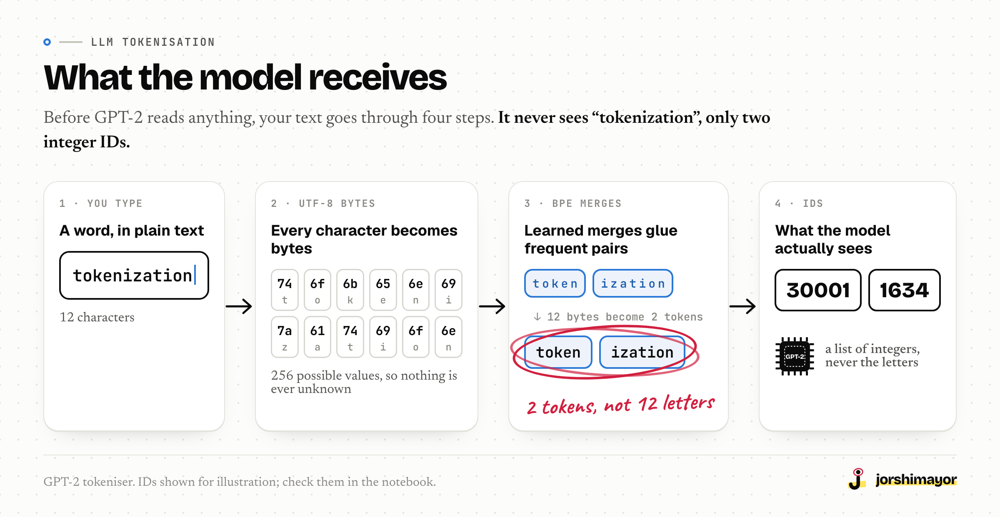
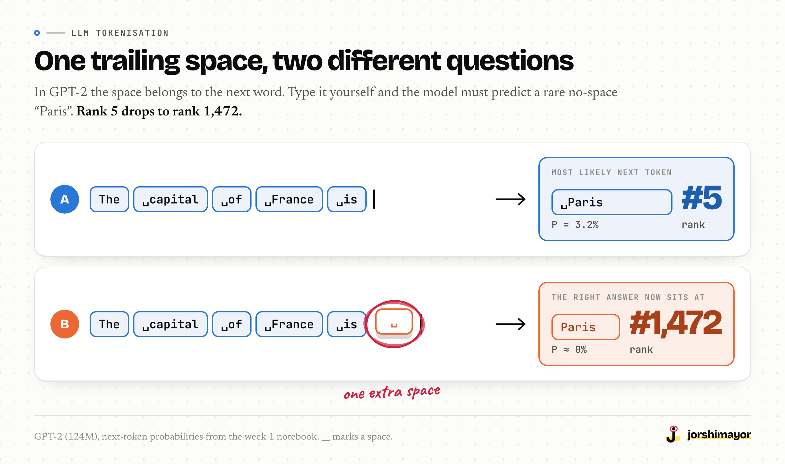
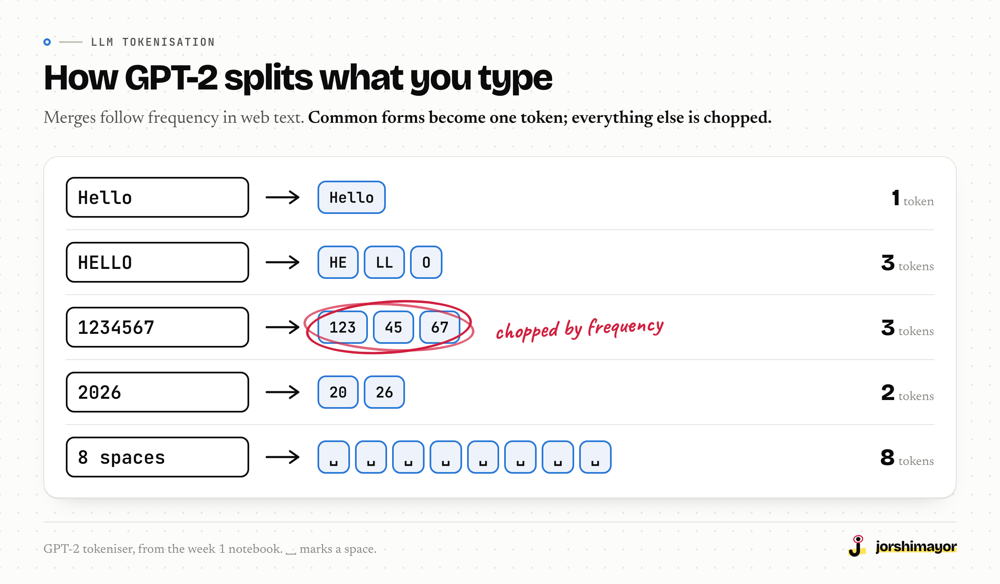
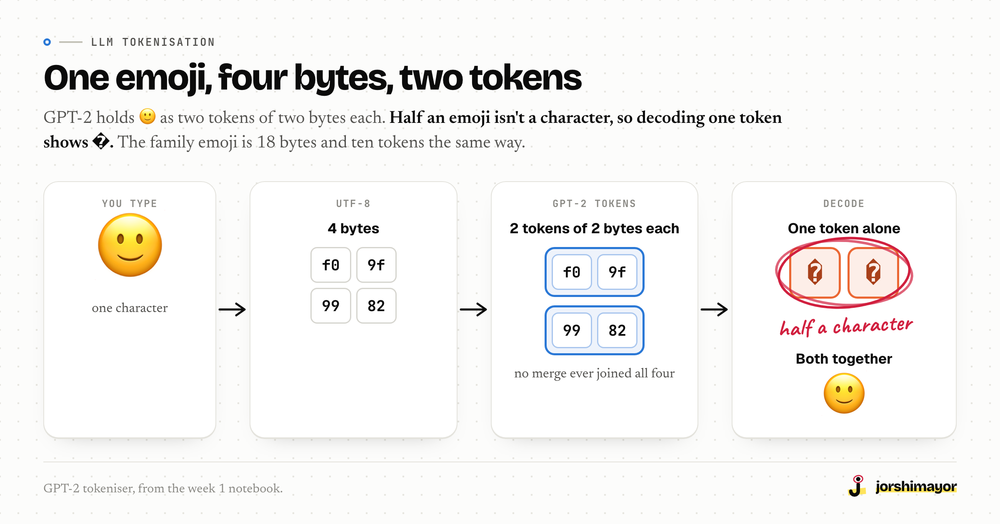
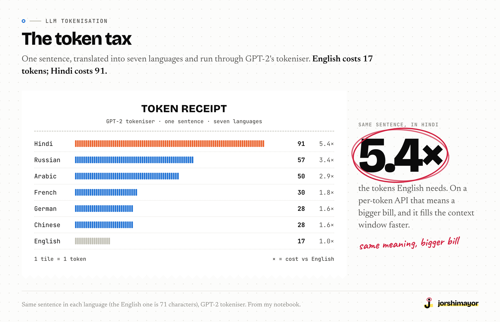
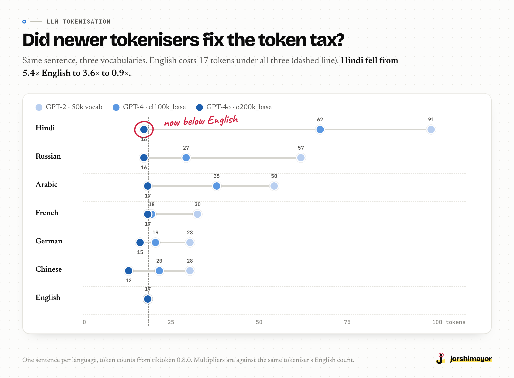
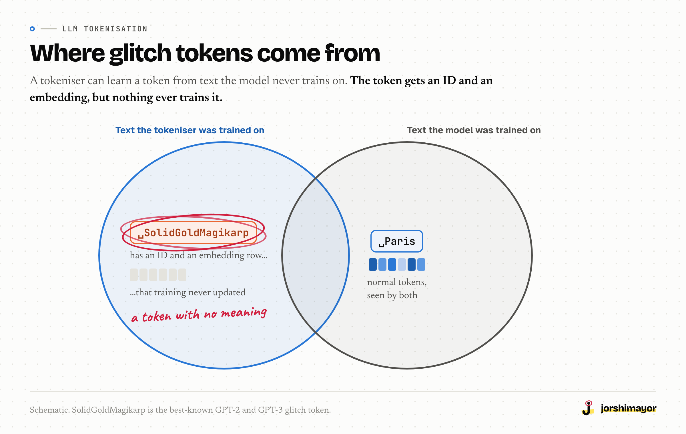
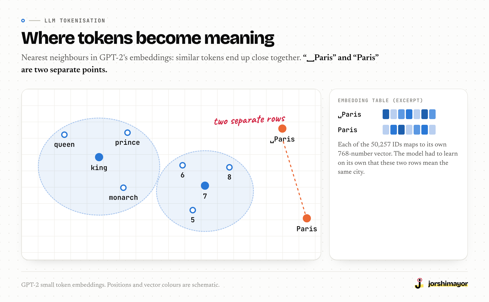

# 7 Things I Learnt About Tokenisation, And One I Got Wrong

Your batch job is almost done. The prompt template is one line, `f"The capital of {country} is "`, and the first few outputs look fine. Then they turn to junk: half-words, stray accents, a non-breaking space where an answer should be. You print the prompt and it looks identical to the one that worked. Tokenisation says otherwise.

You lower the temperature. You rewrite the instructions. You switch to a bigger model. Still junk. The bug is the last character of the template, a space you can't see, and the tokeniser turned it into a token of its own before the model read a word.

I measured exactly that on GPT-2. With "The capital of France is" the model put " Paris" at 3.2%, fifth most likely next token. With "The capital of France is ", one trailing space added, "Paris" fell to roughly 0%, rank 1,472 out of 50,257. Same model, same weights, same question as far as any human can tell.

Every call you make to a language model goes through this step first, and it quietly sets your bill, your context budget, and a whole class of failures that get blamed on the model. I spent a week probing GPT-2's tokeniser and embedding table with [the probe notebook](https://github.com/jorshimayor/AI-Engineering-Flow_Research/tree/main/submissions/week1) to see what the model actually receives. Seven lessons came out of it, and one assumption of mine didn't survive. So what does the model see?



## How Does LLM Tokenisation Work Under the Hood?

The model receives a list of integer IDs. Never characters, never words. GPT-2's vocabulary has 50,257 of them, and tokenisation is the step that turns your string into a sequence drawn from that list. LLM tokenisation is a lookup, with a learned set of rules deciding where one lookup ends and the next begins.

### How Byte Pair Encoding Builds the Vocabulary

Those rules come from byte pair encoding (BPE). Training a byte pair encoding tokeniser starts with the 256 possible byte values as the whole vocabulary. It then scans a large text corpus, finds the pair of adjacent tokens that occurs most often, merges them into one new token, and repeats. "t" and "h" become "th", "th" and "e" become "the", and so on, until the vocabulary hits its target size.

The merges are frozen and shipped with the model. Sennrich and colleagues introduced byte pair encoding for machine translation in [the BPE paper](https://arxiv.org/abs/1508.07909), and GPT-2 adopted it at the byte level.

Byte-level is the part that matters for the quirks below. Because the starting alphabet is every possible byte, there is no string the tokeniser can't encode. There is never an unknown token, and any input round-trips back to the same bytes. I checked this on every string in my probe set, including the ones that produce garbage when you decode a single token on its own.

### One Word, Two Tokens

Take the word "tokenization". The tokeniser reads its bytes, applies the merges in the order they were learned, and stops when no more merges apply. GPT-2 ends up with two tokens, `token` and `ization`, which map to two integers. The model only ever sees those two numbers.

You can watch this happen with six lines. The helper below prints every token's text, and `repr` makes leading spaces visible, which matters for the first quirk.

```python
# transformers==4.49.0, torch==2.2.2, GPT-2 small 124M, CPU
from transformers import AutoTokenizer
tok = AutoTokenizer.from_pretrained("gpt2")

def show(text):
    ids = tok.encode(text)
    print(f"{text!r:16} {len(ids)} tok | " + " ".join(repr(tok.decode([i])) for i in ids))

for t in ["tokenization", "tokenisation", "ChatGPT", "cat"]:
    show(t)
```

```text
'tokenization'   2 tok | 'token' 'ization'
'tokenisation'   2 tok | 'token' 'isation'
'ChatGPT'        3 tok | 'Chat' 'G' 'PT'
'cat'            1 tok | 'cat'
```

Every quirk that follows is a side effect of tokenisation merging whatever happened to be frequent in the training text.

## Why Does a Trailing Space Break the Prompt?

In GPT-2's vocabulary, the space belongs to the word after it. `hello` and ` hello` are different tokens with different IDs and different rows in the embedding table. Most words in running English text appear with a leading space, so the version with the space is the common one and the version without it is comparatively rare.



That explains the hook. "The capital of France is" ends on a clean token, and the natural next token is ` Paris`, space included. The model has seen that token after "is" thousands of times.

When I added a trailing space, tokenisation consumed it as its own token. Now the model has to predict `Paris` with no leading space, a token that almost never follows a bare space in the training data, so it falls to rank 1,472. The space didn't confuse the model. It changed the question.

The proof is in what the model expects instead. Take the softmax over the last position's logits and look at the top of the distribution for both prompts.

```python
import torch
from transformers import AutoModelForCausalLM
model = AutoModelForCausalLM.from_pretrained("gpt2").eval()

@torch.no_grad()
def next_probs(prompt):
    ids = tok(prompt, return_tensors="pt").input_ids
    return torch.softmax(model(ids).logits[0, -1], dim=-1)

for prompt in ["The capital of France is", "The capital of France is "]:
    p = next_probs(prompt)
    v, i = p.topk(6)
    print(repr(prompt), "  ".join(f"{tok.decode([ix])!r} {pr:.1%}" for pr, ix in zip(v, i)))

# Chart it: two panels, same x scale, so the shapes are comparable
import matplotlib.pyplot as plt
fig, axes = plt.subplots(1, 2, figsize=(10, 3), sharex=True)
for ax, prompt in zip(axes, ["The capital of France is", "The capital of France is "]):
    p = next_probs(prompt); v, i = p.topk(6)
    ax.barh([repr(tok.decode([ix])) for ix in i][::-1], (v * 100)[::-1], color="#2a78d6")
    ax.set_title(repr(prompt), fontsize=10); ax.set_xlabel("probability (%)")
plt.tight_layout(); plt.savefig("next-token-after-space.png", dpi=150)
```


After the clean prompt the model spreads its bets across sensible English: ` the`, ` now`, ` a`, ` France`, ` Paris`. After the trailing space it puts 39.8% on a non-breaking space and 34.2% on `ét`, a fragment that only ever follows a space inside French words. Entropy drops from 8.65 bits to 2.55 bits: the model is confident, and confidently predicting garbage.

Spaces are the first thing that splits in a way you wouldn't guess from looking at the text. They aren't the only one.

## Why Do Capitals, Numbers, and Whitespace Cost Extra Tokens?

The next three tokenisation quirks share a cause. Byte pair encoding merges follow frequency in web text, so anything rare in that text gets chopped into smaller pieces. Each piece adds to the token count you pay for, and the model has to reassemble them.



### Capitals Split

`Hello` is one token. `HELLO` is three: `HE`, `LL`, `O`. With a leading space it splits differently again, ` HELL` and `O`. Capitalised words are common enough to earn their own merges. All-caps words are not, so tokenisation falls back to fragments.

The model sees three pieces that have no built-in relationship to the lowercase word, and the token count triples.

### Numbers Are Chopped Arbitrarily

`1234567` becomes `123`, `45`, `67`. `2026` becomes `20`, `26`. The boundaries fall wherever digit pairs and triples were frequent, which has nothing to do with place value.

Adding two seven-digit numbers means lining up chunks that don't align, and the model has to learn arithmetic over a representation that fights it. That's one reason arithmetic is hard for these models, and the second article in this series measures how hard.

### Whitespace Is Not Free

An eight-space indent is eight tokens in GPT-2. `"        return x"` is nine tokens: eight spaces, ` return`, ` x`. Each space is its own token because runs of spaces were rare enough in the training text that long runs never merged. For code, indentation can take a large share of the bill and the context window.

If you've ever wondered why a short Python file has a higher token count than the same amount of prose, this is a big part of the answer.

Those splits happen inside English, which is the language the merges were learned from. Outside English the tokeniser gets more expensive still.

## Why Do Emoji and Non-English Text Pay a Token Tax?

Byte-level tokenisation guarantees that every string can be encoded. It does not guarantee that the encoding is efficient. The merges reward whatever was common in the training corpus, and that corpus was mostly English.

The emoji 🙂 is 4 bytes of UTF-8 and two tokens in GPT-2. Decode either one on its own and you get �, the replacement character, because each token holds only part of the byte sequence. Decode both together and the emoji comes back intact.



The family emoji, three people joined with zero-width joiners, is 18 bytes and ten tokens. 你好 is 6 bytes and four tokens.

Whole scripts pay the same tokenisation price. I encoded one sentence in seven languages and compared the token count to English.

```python
same_sentence = {
    "English": "The weather is beautiful today and I want to go for a walk in the park.",
    "French":  "Il fait très beau aujourd'hui et je veux aller me promener dans le parc.",
    "German":  "Das Wetter ist heute wunderschön und ich möchte im Park spazieren gehen.",
    "Russian": "Сегодня прекрасная погода, и я хочу погулять в парке.",
    "Chinese": "今天天气很好，我想去公园散步。",
    "Arabic":  "الطقس جميل اليوم وأريد أن أذهب للتنزه في الحديقة.",
    "Hindi":   "आज मौसम बहुत सुंदर है और मैं पार्क में टहलने जाना चाहता हूँ।",
}
base = len(tok.encode(same_sentence["English"]))
counts = {lang: len(tok.encode(s)) for lang, s in same_sentence.items()}
for lang, n in counts.items():
    print(f"{lang:8} {n:3} tokens {n/base:.1f}x")

order = sorted(counts, key=counts.get)
plt.figure(figsize=(7, 3))
plt.barh(order, [counts[l] for l in order], color="#2a78d6")
plt.xlabel("GPT-2 tokens for the same sentence"); plt.tight_layout(); plt.savefig("token-tax.png", dpi=150)
```



English takes 17 tokens. Hindi takes 91, which is 5.4 times as many for the same sentence. Russian needs 3.4 times, Arabic 2.9 times, French 1.8 times. Chinese is only 15 characters and still costs 28 tokens, because every character is split into partial bytes. Petrov and colleagues documented the same pattern across many tokenisers in [Language Model Tokenizers Introduce Unfairness Between Languages](https://arxiv.org/abs/2305.15425).

This tax has three costs. You pay per token, so the same question costs more in Hindi. The context window is measured in tokens, so it holds about a fifth as much Hindi text. And every downstream limit, from rate limits to output caps, hits non-English users first. Tokenisation decides who pays, before the model has done anything.

### Did Newer Tokenisers Fix the Token Tax?

GPT-2's vocabulary has 50,257 entries. GPT-4's `cl100k_base` has about 100,000 and GPT-4o's `o200k_base` about 200,000, and both were trained on more multilingual text. I ran the same seven sentences through all three with `tiktoken`.

```python
# pip install tiktoken==0.8.0
import tiktoken
encs = {n: tiktoken.get_encoding(n) for n in ["gpt2", "cl100k_base", "o200k_base"]}
print(f"{'lang':8}" + "".join(f"{n:>14}" for n in encs))
for lang, s in same_sentence.items():
    print(f"{lang:8}" + "".join(f"{len(e.encode(s)):>14}" for e in encs.values()))
```



| Language | GPT-2, 50k | GPT-4, cl100k_base | GPT-4o, o200k_base |
|---|---|---|---|
| English | 17 (1.0×) | 17 (1.0×) | 17 (1.0×) |
| Hindi | 91 (5.4×) | 62 (3.6×) | 16 (0.9×) |
| Russian | 57 (3.4×) | 27 (1.6×) | 16 (0.9×) |
| Arabic | 50 (2.9×) | 35 (2.1×) | 17 (1.0×) |
| French | 30 (1.8×) | 18 (1.1×) | 17 (1.0×) |
| German | 28 (1.6×) | 19 (1.1×) | 15 (0.9×) |
| Chinese | 28 (1.6×) | 20 (1.2×) | 12 (0.7×) |

Two things stand out. English never moved: 17 tokens under all three vocabularies, because English was already well covered in 2019 and a bigger vocabulary had nothing left to merge. Everything else collapsed towards it. GPT-4's tokeniser cut the Hindi tax from 5.4× to 3.6×. GPT-4o's tokeniser removed it: 16 tokens for Hindi, one fewer than English. The extra 150,000 vocabulary entries went almost entirely to languages other than English.

That is one sentence per language, so treat the multipliers as a demonstration, not a benchmark. The direction is clear, though: the token tax is a property of the tokenisation vocabulary, not of the language, and a vocabulary trained on multilingual text makes it go away.

A vocabulary learned from web text also contains things nobody meant to put there.

## What Are Special Tokens and Glitch Tokens?

Two kinds of token sit in GPT-2's tokenisation vocabulary that no user would type on purpose.

The first is the special token `<|endoftext|>`, which marks the end of a document during training. In GPT-2's tokeniser, typing that exact string as plain text produces the real end-of-sequence token, ID 50256. If your application passes user input straight into the prompt, a user can inject a control token the model treats as "the document ended here".

```text
'Hello<|endoftext|>world'   3 tok | 'Hello':15496 '<|endoftext|>':50256 'world':6894
```

Sanitise special tokens in anything a user can type. Tokenisation will not do it for you.

The second kind is glitch tokens. ` SolidGoldMagikarp` is a single token in GPT-2's vocabulary, ID 43453, and so are ` TheNitromeFan`, ` davidjl`, and ` RandomRedditorWithNo`. They were Reddit usernames that appeared often enough in the data used to train the tokeniser to earn their own merges. The model's training data was filtered differently and barely contained them, so the tokens exist but the model learned almost nothing about them.

Rumbelow and Watkins catalogued the strange behaviour glitch tokens cause in [the SolidGoldMagikarp write-up](https://www.lesswrong.com/posts/aPeJE8bSo6rAFoLqg/solidgoldmagikarp-plus-prompt-generation).



The gap between the two datasets is the whole story. The tokeniser saw text the model never did, and the leftovers are glitch tokens: a name with no meaning behind it. I had a theory about where those tokens live in the model. It was wrong.

## What I Got Wrong About Glitch Tokens

My hypothesis: glitch tokens barely got trained, so their embedding vectors should sit near the centroid of the embedding table, close to where an untrained row would end up. The published work on GPT-J pointed that way, and it felt obvious.

The test is short: subtract the mean embedding, take each row's distance from it, and rank.

```python
W = model.transformer.wte.weight.detach()        # (50257, 768)
dist = (W - W.mean(0)).norm(dim=1)
rank = dist.argsort()                              # 0 = closest to the centroid
pos = torch.empty_like(rank); pos[rank] = torch.arange(len(rank))
print([tok.decode([i]) for i in rank[:8]])
for g in [" SolidGoldMagikarp", " RandomRedditorWithNo", " the", " dog"]:
    i = tok.encode(g)[0]
    print(f"{g!r:24} percentile {100 * pos[i] / len(W):.1f}%")
```

```text
[' externalToEVA', '�', '�', '\x1c', '\x07', '�', 'quickShip', '\x19']
' SolidGoldMagikarp'      percentile 28.6%
' RandomRedditorWithNo'   percentile 12.5%
' the'                    percentile 25.2%
' dog'                    percentile 12.0%
```

GPT-2 disagreed with me. In its tokenisation vocabulary, ` SolidGoldMagikarp` sits at percentile 28.6 of distance from the centroid, and the four famous glitch tokens span 12.5% to 49.9%. ` the` and ` dog`, two of the best-trained tokens in the vocabulary, sit at 25.2% and 12.0%. On this measure the glitch tokens look ordinary.

The tokens that do sit closest to the centroid are junk of a different sort: ` externalToEVA`, `quickShip`, partial UTF-8 bytes, and a run of raw control characters. Those look like the leftovers of scraped code and markup, not usernames. So distance to the centroid does find under-trained tokens, just not the ones I went looking for.

The lesson I'm taking from it: a finding published on one model doesn't automatically transfer to another, even when the models share a tokeniser family. If a result matters to you, measure it on the model you use. The percentile table is in the notebook if you want to check my working.

## Where Does Tokenisation End and Meaning Begin?

Every quirk so far happens during tokenisation, before the model does any work. The embedding layer is where the integers finally turn into something the network can reason over.

Each of GPT-2's 50,257 IDs maps to a row in a table, and each row is a 768-dimensional vector. Those vectors are learned during training, and they end up encoding similarity.

I pulled the nearest neighbours of a few tokens by cosine similarity.

```python
Wn = W / W.norm(dim=1, keepdim=True)
def neighbours(word, k=6):
    i = tok.encode(word)[0]
    top = (Wn @ Wn[i]).topk(k + 1).indices[1:]
    print(f"{word!r:9} -> " + ", ".join(repr(tok.decode([j])) for j in top))

for w in [" king", " 7", " Paris"]:
    neighbours(w)
```

```text
' king'   -> ' kings', ' King', ' queen', 'King', ' prince', ' monarch'
' 7'      -> ' 6', ' 8', ' 5', ' 9', ' 4', ' 3'
' Paris'  -> 'Paris', ' France', ' French', ' London', 'France', ' Copenhagen'
```

` king` sits next to ` queen`, ` prince`, and ` monarch`, with its own case and plural variants in between. ` 7` sits next to ` 6`, ` 8`, and ` 5`.



Here's the catch. ` Paris` and `Paris` are two separate rows. They end up as each other's nearest neighbour, which means the model learned, from examples alone, that they refer to the same city. Same for `Hello` and the three fragments of `HELLO`, and for every number that splits differently depending on its neighbours.

Every tokenisation choice is work the model has to undo later, and GPT-2 undoes a lot of it. The trailing-space result shows where it stops being able to.

This is also where the 2017 transformer paper begins. In [Attention Is All You Need](https://arxiv.org/abs/1706.03762), the first box in the architecture diagram is the input embedding, and the paper's own experiments used a byte pair encoding vocabulary of about 37,000 tokens. Everything the paper is famous for, attention included, runs on top of the lookup described in this article. The third piece in this series rebuilds that attention layer by hand.

## Look at the Tokens Before You Blame the Model

Back to the batch job. The prompt looked right, the model looked broken, and the bug was one invisible character that tokenisation turned into a token of its own. Every quirk in this article has the same shape: something you can't see in the text changes what the model receives, and the model takes the blame.

So the habit that follows is simple. When an LLM does something strange, print the tokens before you touch the temperature. `tok.encode(prompt)` is one line, and it would have found the trailing space in a second. From there, four rules cover most of what tokenisation will do to you:

- Never end a prompt with a space. Let the model supply the space with its first token.
- Budget in tokens, not characters. The gap is largest for code, digits, and anything outside English.
- Test digits and non-English input on purpose, because that's where the splits are worst.
- Sanitise special tokens in anything a user can type before it reaches the model.

Two things I'll carry into the next experiments. The token tax is a property of the vocabulary, not the language: the same Hindi sentence costs 91 tokens under GPT-2 and 16 under GPT-4o, so check the tokeniser of the model you actually call before you assume non-English is expensive. And a published finding is a hypothesis for your model, not a fact about it. The glitch-token result from GPT-J didn't survive contact with GPT-2's embedding table, and the only way I found out was by measuring.

Everything here runs on a laptop in about a minute: [the probe notebook](https://github.com/jorshimayor/AI-Engineering-Flow_Research/tree/main/submissions/week1) covers GPT-2 small with `transformers` 4.49.0 and `torch` 2.2.2, and `tiktoken` 0.8.0 for the three-vocabulary comparison. It's single prompts on one small model, so it demonstrates the tokenisation mechanism rather than measuring a population. Rerun it on the model you use and see which of the seven still hold.

The next piece takes the number-splitting quirk and measures what it does to arithmetic. You'll find it with [more experiments in this series](https://jorshimayor.is-a.dev/work), watch [the video walkthrough](https://www.youtube.com/@jorshimayor), or get [new experiments by email](https://jorshimayor.substack.com) as they land.
